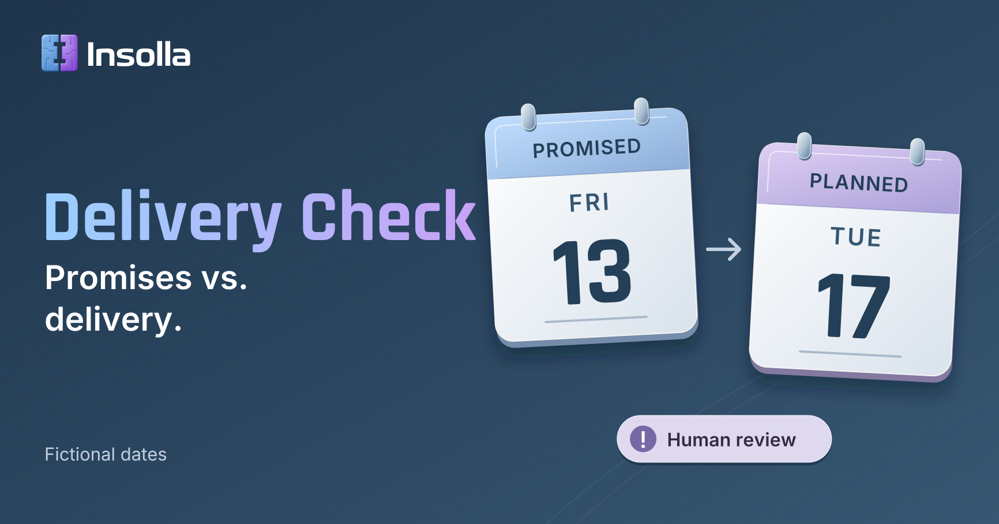

# Delivery Check

**Compare client commitments with delivery work.**

Delivery Check is a planned AI automation demo by Insolla. It compares promises recorded in Google Sheets with explicitly linked Asana tasks, surfaces discrepancies, and prepares a source-linked Google Docs report for a manager to review.

*Concept graphic with fictional dates. It illustrates the proposed demo; it is not a screenshot of a working integration.*

## Project status

**Planning and documentation only. Application implementation has not started.** This repository currently contains the README, the [project brief](PROJECT-BRIEF.md), and the concept graphic. Integrations, access, application behavior, and tests remain unverified.

The project name is **Delivery Check**, two words. The repository uses the conventional hyphenated slug `Delivery-Check`.

## The demo in one example

A commitment register promises a training guide on **Friday, November 13, 2026**. The linked Asana task is scheduled for **Tuesday, November 17, 2026**.

The proposed demo would show both records, identify the four-calendar-day difference in TypeScript, use AI to explain only the supplied comment evidence, and produce a report with source links and useful review questions. A later planned date is a scheduling discrepancy; it does not prove actual customer delivery was late.

The first walkthrough uses **one fictional project and five fictional commitments**: aligned dates, a date mismatch, overdue or explicitly blocked work, an unmatched record, and a completed task. All clients, people, notes, and dates are invented. The target walkthrough is 2–3 minutes.

## Proposed flow

1. **Read:** Google Sheets commitments and explicitly linked Asana tasks/comments.
2. **Compare:** Node.js and TypeScript validate identifiers, normalize dates, and produce deterministic findings.
3. **Explain:** OpenAI drafts evidence-grounded context and review questions.
4. **Report:** Google Docs presents findings, source links, coverage, and unable-to-assess records for human review.

## Safeguards

- Source systems stay read-only during checks. No automatic customer emails, task updates, or assignment changes.
- Explicit task IDs establish matches; no fuzzy matching in the first demo.
- Code determines date/status findings. AI must not invent delay causes, infer completion from vague notes, or assign blame.
- Missing, inaccessible, stale, or partially read records stay visible. An unmatched task is unable to assess, never automatically on track.
- Verified discrepancies remain visible if AI output fails. Reports disclose uncertainty and require human review.
- Use fictional data only. Credentials and secrets do not belong in this repository or chat.

## Documentation and next steps

Start with the **[complete project brief](PROJECT-BRIEF.md)** for the data contract, comparison rules, five proposed fixtures, validation plan, staged implementation, storyboard, and open decisions.

Before building, confirm the available accounts and permissions, existing code, business timezone, freshness rules, report identity/retention, and implementation scope. There are no install, run, or deployment instructions yet. The full tutorial will be written after implementation and verification.
